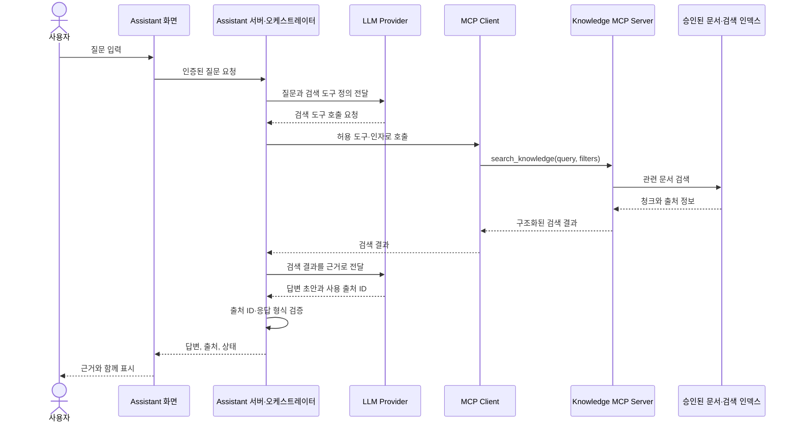

# ADR-0001: KTcs Assistant 시스템 경계와 데이터 흐름

- 상태: 제안
- 작성일: 2026-10-15
- 결정자: 팀 검토 필요

## 맥락

KTcs 업무지식 검색·활용 Assistant를 8주 안에 구현해야 합니다. 현재 작업공간에는 조직 공통 규칙 저장소 `.github`, 사용자 화면 중심의 `ai-assistant`, 문서·청크·MCP 기능을 둘 `knowledge-mcp`가 있습니다. KTcs가 제공한 업무 데이터는 없고, 프레임워크·배포 방식·인증 조건도 확정되지 않았습니다.

따라서 먼저 데이터·AI·사용자 화면의 책임을 나누고, 허용된 샘플로 전체 흐름과 품질 평가를 개발할 수 있는 경계를 정합니다. 이 문서는 그 경계에 대한 제안이며, 팀과 검토 후 상태를 갱신합니다.

## 현재 작업공간

```text
   project/
    ├── .github/                  조직 공통 README, 협업 규칙, Issue·PR 템플릿
    ├── ai-assistant/             현재 사용자 화면 프로젝트 구조
    │   ├── src/api/              API 연결 경계
    │   ├── src/features/         질문·답변 등 화면 기능
    │   ├── src/shared/           공통 UI와 유틸리티
    │   ├── public/               정적 파일
    │   ├── tests/                테스트
    │   └── docs/                 프로젝트 문서 및 ADR
    └── knowledge-mcp/            지식 데이터 및 MCP 프로젝트 구조
        ├── data/sources/         출처가 확인된 원문
        ├── data/chunks/          문서 청크 JSONL
        ├── data/manifests/       출처·이용 조건 목록
        ├── schemas/              데이터 형식
        ├── src/ingestion/        수집·정제·청킹 처리
        ├── src/mcp/              MCP 서버와 도구
        ├── tests/                테스트
        └── docs/adr/             설계 결정
```

현재 앱 저장소의 `src/`, `tests/`, `public/`, `docs/` 및 Knowledge MCP의 `src/`, `data/`, `tests/`는 대부분 빈 폴더를 Git에서 보존하기 위한 자리 표시자입니다. 구현 프레임워크와 실행 명령은 아직 정해지지 않았습니다. 오케스트레이션 API를 담는 별도 저장소도 현재 없습니다.

## 선택지

- 현재 세 저장소를 유지하고 `ai-assistant` 안에 화면과 별도 서버 모듈을 둡니다.
- `ai-assistant`와 `knowledge-mcp` 외에 Assistant API 전용 저장소를 추가합니다.
- 화면, 서버, 데이터·MCP를 처음부터 한 저장소로 합칩니다.

## 결정 제안

8주 MVP에서는 현재 저장소 세 개를 유지합니다. `ai-assistant` 저장소 안에서 화면과 서버 측 오케스트레이션 코드를 분리된 디렉터리·모듈로 관리하고, `knowledge-mcp`는 문서 처리·검색·MCP 도구를 소유합니다. `.github`에는 조직 공통 협업 규칙과 템플릿을 둡니다.

서버 모듈은 모델 호출, 비밀키 관리, 사용자 요청 처리, MCP Client 연결, 답변의 출처 검증을 담당합니다. 브라우저에서 LLM Provider나 MCP 서버를 직접 호출하지 않습니다. 팀이 사용할 언어·프레임워크는 보유 역량과 배포 제약을 확인한 뒤 정하고, 이 ADR에서는 특정 기술을 확정하지 않습니다.

별도 서버 저장소는 독립 배포·소유 팀·보안 경계가 실제로 필요해질 때 검토합니다. 저장소 수를 늘리는 것만으로 시스템 경계가 생기는 것은 아니므로, 우선 코드와 계약으로 경계를 명확히 합니다.

## 제안 시스템 구조



모델이 도구 호출을 지원하지 않는 경우에는 서버가 먼저 MCP 검색을 실행하고 검색 결과를 모델 입력에 포함하는 방식으로 대체할 수 있습니다. 두 방식 모두 검색 결과에 없는 출처를 답변에 붙이지 않으며, 근거가 부족하면 답변을 제한합니다.

## 제안서 요구사항과 MVP 범위

제안서의 핵심 요구는 자연어로 업무자료를 검색하고, 검색된 내용을 답변·요약과 함께 제시하며, 사용자가 답변의 근거와 출처를 확인할 수 있게 하는 것입니다. 여러 문서 비교·요약과 절차 안내도 요청되어 있으나, 8주 안에 모든 업무 영역을 폭넓게 다루기보다 승인된 공개 자료 중 한정된 주제와 대표 시나리오에서 끝까지 검증하는 편이 일정과 결과 해석에 유리합니다.

| 범위 제안 | 사용자 결과 | 확인 방법 |
| --- | --- | --- |
| 핵심 MVP 제안 | 자연어 질문으로 관련 문서 검색 | 대표 질문별 기대 문서가 검색 결과에 포함되는지 측정 |
| 핵심 MVP 제안 | 검색 근거에 기반한 답변과 문서 출처 제공 | 답변의 각 출처 ID가 실제 검색 결과와 일치하는지 확인 |
| 핵심 MVP 제안 | 근거 부족·검색 실패 시 한계를 표시 | 무응답·오류 시나리오에서 내용을 지어내지 않는지 검증 |
| 시나리오 선택 후 포함 제안 | 핵심 내용 요약과 2개 이상 문서의 비교 | 비교 대상 문서와 공통점·차이점이 근거 위치에 연결되는지 확인 |
| 시나리오 선택 후 포함 제안 | 업무 절차 안내 | 한 가지 절차 시나리오를 단계별 근거 문서와 함께 안내하는지 확인 |
| 최종 결과물 | 최종 보고서와 발표·시연 자료 | Pain Point, 구조, 기능, 검색·답변 평가, 사용자 검증, 한계가 정리됨 |

정확도나 시간 절감의 목표 수치는 제안서에 지정되어 있지 않습니다. 대표 질문, 비교할 기존 검색 방식, 사용자 검증 절차를 먼저 정하고 결과로 측정값을 제시합니다. 사용자 수와 표본이 제한되면 이를 기업 전체의 효과로 일반화하지 않습니다.


## 저장소별 책임과 계약

| 영역 | 책임 | 계약·산출물의 기준 저장소 |
| --- | --- | --- |
| `.github` | 공통 브랜치·커밋·PR 규칙, 템플릿, 조직 소개 | `.github` |
| Assistant 화면 | 질문 입력, 답변·출처 표시, 로딩·오류·결과 없음 상태 | `ai-assistant` |
| Assistant 서버 | 인증 경계, 요청 처리, 모델 호출, MCP Client, 출처 검증, 안전한 로그 | `ai-assistant`의 서버 모듈 |
| Knowledge MCP | 출처 manifest, 문서 처리, 청크 스키마, 검색, MCP 도구 | `knowledge-mcp` |
| 데이터 | 원문·청크·출처·재사용 조건 관리 | `knowledge-mcp` |

Assistant API 계약은 `ai-assistant`가, MCP 도구와 Knowledge 응답 스키마는 `knowledge-mcp`가 원본을 관리합니다. 소비 저장소에 계약 파일을 복사해 별도로 수정하지 않습니다. 계약을 바꾸면 소유 저장소 PR에서 변경 내용을 먼저 검토하고, 소비자 호환성 확인과 통합 시나리오를 함께 갱신합니다.

## 데이터 준비와 답변 원칙

- 재사용·재배포 조건이 확인된 공개 문서
- 합성 문서와 합성 질문

출처나 재사용 조건이 불분명한 자료는 원문이나 청크 텍스트를 Git에 올리지 않고 manifest에 확인 상태만 기록합니다. 공개·합성 자료로 만든 시연 결과는 KTcs 내부 지식에 대한 정확도 검증으로 표현하지 않습니다.

답변은 가능한 경우 문서명, 출처 URI, 페이지·절 등 위치 정보를 보여줍니다. 검색 결과가 없거나 근거가 불충분하면 추측을 사실처럼 답하지 않습니다. 모델 응답의 출처 ID가 실제 검색 결과에 포함되는지 서버가 확인합니다.

## 품질·보안·운영 기준

- 질문, 검색 결과, 답변이 한 번에 확인되는 대표 시나리오를 만든 뒤 검색 품질과 답변 근거성을 각각 평가합니다.
- 평가 질문에는 기대 출처를 기록해 검색 결과가 근거 문서를 찾았는지 재현 가능하게 확인합니다.
- 검색 결과 없음, MCP 장애, 모델 타임아웃, 잘못된 출처 ID에 대한 사용자 상태와 서버 동작을 정합니다.
- API 키와 자격 증명은 서버 환경에 보관하고, 질문 원문·개인정보·비밀값은 일반 로그에 남기지 않습니다.
- 요청 ID와 단계별 처리 시간·오류 유형을 기록해 병목과 실패 구간을 확인할 수 있게 합니다.
- 벡터 데이터베이스, 비동기 작업 큐, Outbox, SSE, Kubernetes는 요구사항과 운영 필요가 확인될 때 도입 여부를 결정합니다.

각 작업 Issue에는 문제와 목적, 산출물, 선행 조건, 담당자, 완료 기준, 확인 방법을 적습니다. 한 이슈는 한 번의 리뷰에서 완료 여부를 판단할 수 있을 정도로 나눕니다. 예를 들어 “검색 구현” 대신 “허용 문서에서 상위 검색 결과를 반환하고 각 결과에 `source_id`와 위치를 포함한다”처럼 작성합니다.

## 아직 확인할 사항

- 사용자의 로그인·조직 권한과 문서별 접근 정책
- 배포 환경, 모델 Provider 및 외부 네트워크 사용 가능 여부
- 대표 질문과 정답 근거, 고객이 기대하는 답변 품질 기준
- Assistant 서버를 `ai-assistant`에 둘지, 별도 서비스로 배포할지에 대한 팀 합의
- 팀이 실제로 익숙한 언어·프레임워크와 지원 가능한 운영 방식
- 검색·답변 정확성 및 업무시간 절감효과를 비교할 기존 검색 기준과 사용자 테스트 표본·절차

## 결과와 트레이드오프

- 저장소 세 개를 유지해 Issue·PR과 배포 경계의 복잡도를 억제할 수 있습니다.
- 화면과 서버를 한 저장소에 두더라도 API 모듈 경계를 지켜 나중에 분리할 수 있습니다.
- KTcs 데이터가 없어도 허용된 샘플로 기술 흐름과 평가 도구를 준비할 수 있지만, 고객 업무 적합성은 실제 승인 데이터가 확보될 때까지 검증되지 않습니다.
- 저장소 간 계약과 통합 검증을 관리해야 하며, 인증·배포 요구가 확인되면 이 제안을 다시 검토해야 합니다.
